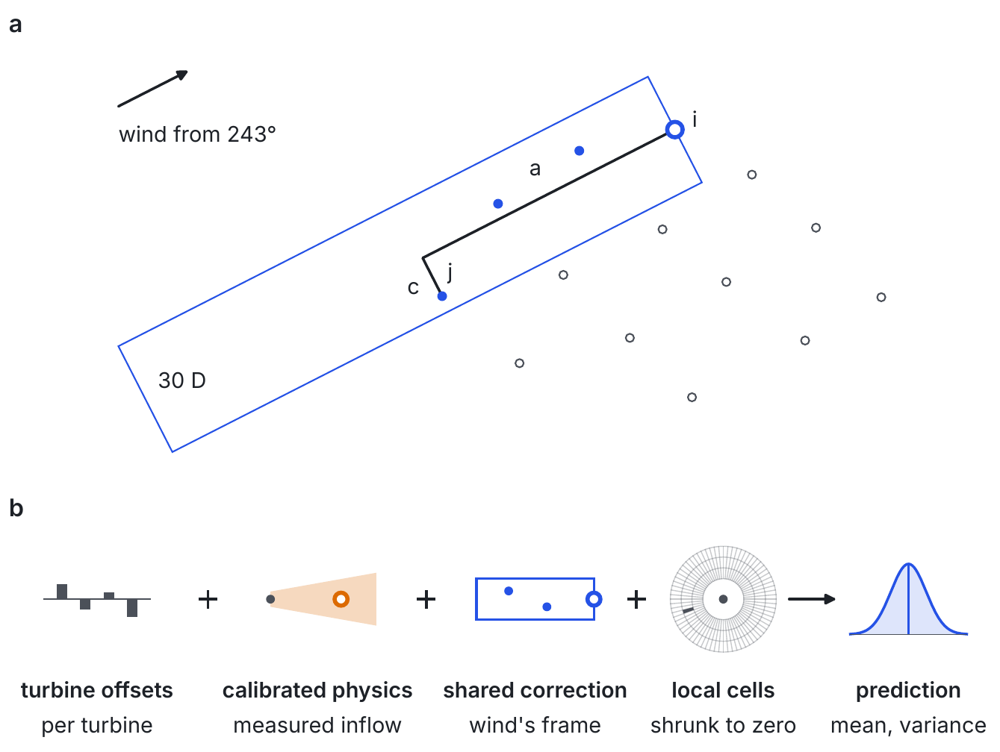
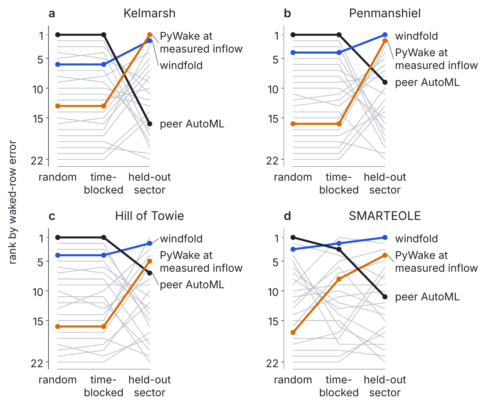

<div align="center">

# windfold

**wind-farm wake interactions learned from SCADA and tested on wind directions held out from training**

[](https://github.com/nikhil-yn-aix/windfold/actions/workflows/checks.yml) [](pyproject.toml) [](LICENSE)

[results](docs/results.md) &nbsp;·&nbsp; [method](docs/method.md) &nbsp;·&nbsp; [comparison models](docs/baselines.md) &nbsp;·&nbsp; [reproduce](docs/reproduce.md) &nbsp;·&nbsp; [data](docs/data) &nbsp;·&nbsp; [study plan](docs/study_plan.md)

</div>

<br>

turbines in a wind farm take wind from one another, and the wind direction decides which turbine stands in whose wake. a model learned from a farm's SCADA records is fitted on the directions its history happened to cover and then used in others. windfold estimates each turbine's power relative to the other turbines at the same time from parts that carry across directions: an offset per turbine, calibrated PyWake physics at the measured turbulence, a fitted weight on that physics and one correction shared by every turbine pair, written in the wind's frame as a function of how far an upstream turbine sits along and across the wind. a relation learned from one pair in one direction then applies to every pair with that relation in any direction. local cells per turbine, direction and speed absorb what the shared parts miss and are shrunk toward zero, so in a direction without training rows the estimate leans on the shared parts. every estimate comes with a predictive variance.

<p align="center"></p>

the repository also holds the benchmark windfold was tested on: 23 models on four open SCADA datasets, from per-turbine power curves through gradient-boosting machines (GBMs) and graph networks to AutoML on the other turbines' power, and from calibrated wake physics to physics with learned corrections. each model is scored on waked rows, the records of turbines standing in another turbine's wake, under random, time-blocked and held-out-sector validation, where a held-out sector is a 30-degree band of wind direction withheld from every fit. the models were compared on a development window of each farm, then fixed and run once on a confirmation period, four later years of one farm, with each model refitted within those years.

## results

skill is the percentage of a no-wake model's squared error that a model removes on waked rows; differences are skill points, with 95% block-bootstrap intervals.

held-out sectors reorder the models. on the three larger datasets, Kelmarsh, Penmanshiel and Hill of Towie, random and time-blocked validation rank 22 models almost alike (Kendall's τb 0.93 to 0.98), but the time-blocked and held-out-sector rankings hardly agree (−0.11 to 0.05). peer AutoML, which reads the other turbines' power and ranks first under time-blocked validation there, falls from 65 to 78 skill points to between −7 and 19, while calibrated PyWake keeps its skill and rises to near the top.

<p align="center"></p>

what carries into an unseen direction is what the directions share: each turbine's level, the geometry of turbine pairs relative to the wind and the wake's physical form. calibrated physics at measured inflow still leaves 54% of the no-wake model's error in held-out sectors, and a correction of windfold's form learned on the other sectors removes about 3 points of it.

on the confirmation period, Penmanshiel 2020 to 2023, windfold beat PyWake at the same measured inflow on held-out sectors by 1.36 skill points (1.08 to 1.64), most in the least frequent sectors: 1.99% lower squared error and 2.57 kW lower mean absolute error per turbine record. on the development farms the same margin ran from −0.5 to 3.1 points, and the confirmation rests on one farm.

none of the four tests fixed with a decision rule before the main experiments was supported under that rule. of three tests set before the confirmation period was scored, two held: a GBM given both turbine identity and wind-frame features beat each kind alone, and a tighter shared correction without local cells beat windfold by 0.75 points. the third, a recalibrated alarm threshold for monitoring after 30 days of history, brought alarm rates on days without an injected power drop to 2.1 to 5.3%, against 13.4 to 16.3% under the standard threshold, but established no detection advantage for windfold. [docs/results.md](docs/results.md) has the per-farm results, the planned tests and the limits.

## install

```bash
git clone https://github.com/nikhil-yn-aix/windfold.git
cd windfold
uv sync --locked --extra cpu --group automl
```

the locked environment needs Python 3.12 and [uv](https://docs.astral.sh/uv/) on Linux x86-64, the only platform the lockfile resolves for. `--extra cpu` installs torch without CUDA and runs everywhere. with an NVIDIA GPU, `--extra gpu` installs torch built for CUDA 12.6, which the graph networks and peer AutoML then use.

## reproduce

```bash
uv run windfold fetch
uv run windfold run development confirmatory
uv run windfold status
```

`fetch` downloads the four datasets and checks every file against its published MD5. `run` plans every job of both studies, runs what is not done and resumes where it stopped. model jobs wait until each farm's data and each model family are released with `windfold release`, and the confirmation period is scored only after two freeze records are written. [docs/reproduce.md](docs/reproduce.md) gives the full sequence and where every output lands.

## data

<div align="center">

| farm | turbines | years | license | source |
|:--|:--|:--:|:--|:--|
| Kelmarsh, England | 6 Senvion MM92 | 2017 to 2024 | CC BY 4.0 | [10.5281/zenodo.16807551](https://doi.org/10.5281/zenodo.16807551) |
| Penmanshiel, Scotland | 14 Senvion MM82 | 2016 to 2023 | CC BY 4.0 | [10.5281/zenodo.16807304](https://doi.org/10.5281/zenodo.16807304) |
| Hill of Towie, Scotland | 21 Siemens SWT-2.3-VS-82 | 2023 to 2025 | CC BY 4.0 | [10.5281/zenodo.22662930](https://doi.org/10.5281/zenodo.22662930) |
| SMARTEOLE, France | 7 Senvion MM82 | 2020 | Etalab Open Licence 2.0 | [10.5281/zenodo.7342466](https://doi.org/10.5281/zenodo.7342466) |

</div>

each farm's card in [docs/data](docs/data) records what was read, the quirks found, every dropped row with its reason and checks made by hand.

## citation

```bibtex
@software{windfold,
  author  = {{Y N}, Nikhil},
  title   = {windfold: wind-farm wake interactions learned from SCADA},
  year    = {2026},
  version = {0.1.0},
  url     = {https://github.com/nikhil-yn-aix/windfold}
}
```

[CITATION.cff](CITATION.cff) holds the same record.

## license

the code is under the [MIT license](LICENSE) and the bundled Inter fonts under the SIL Open Font License 1.1. each dataset keeps its own license, listed above.

## acknowledgements

Kelmarsh and Penmanshiel data are published by Cubico Sustainable Investments, Hill of Towie data by RES on behalf of TRIG and SMARTEOLE data by ENGIE Green, whose record asks for this sentence: "The dataset used in this research has been obtained by ENGIE Green in the scope of French national project SMARTEOLE (grant no. ANR-14-CE05-0034)." wake physics comes from [PyWake](https://gitlab.windenergy.dtu.dk/TOPFARM/PyWake) by DTU Wind Energy.
