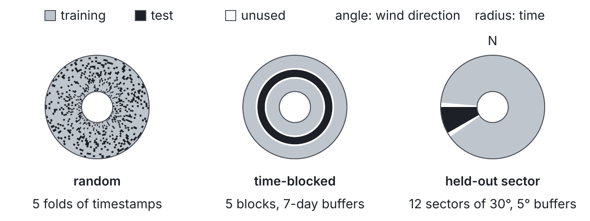

# results

windfold and 22 comparison models ([baselines.md](baselines.md)) estimate each turbine's power relative to its peers ([method.md](method.md)) on four open SCADA datasets. [reproduce.md](reproduce.md) names the output file behind each number.

## how the models are scored

random validation splits the timestamps into five folds. time-blocked validation tests five contiguous, month-aligned blocks, with seven days on each side of the test block dropped from training (SMARTEOLE: four blocks, three-day buffers). held-out-sector validation tests each of twelve 30-degree sectors of wind direction after dropping it and 5 degrees on each side from training, since a direction measured just outside a sector may lie inside it. a sector needs at least 300 turbine rows on at least 10 days, which leaves 12, 12, 12 and 11 sectors on the four farms, seven of SMARTEOLE's with waked rows.

each farm's record is split in time. a calibration window calibrates the wake physics, tunes the learners and fits the data processing, and the development window that follows compares the models and chose windfold's configuration. the confirmation period, Penmanshiel 2020 to 2023, was scored once after every model was fixed, with each model refitted on the training rows of each split from those four years. SMARTEOLE has no calibration window and takes the other farms' median physics parameters and best-ranked learner configurations. the calibration window saw every direction, held-out sectors included: recalibrating the physics without each held-out sector cost PyWake at measured inflow 0.37, 0.18 and 0.46 skill points at Kelmarsh, Penmanshiel and Hill of Towie and changed windfold by +0.12, −0.03 and −0.01, so calibrating on every direction narrows windfold's margin over the physics rather than widening it.

skill is 100 (1 − MSE / MSE₀) on waked rows ([method.md](method.md)), pooled over every split of a validation, where MSE is a model's mean squared error and MSE₀ that of the no-wake model on the same rows. differences in skill are skill points. intervals are 95% percentile intervals from a paired bootstrap of 7-day calendar blocks: each of 10,000 replicates draws one set of blocks for every model and split and redraws the three seeds of the GBMs and graph networks, without refitting, so the intervals are conditional on the fitted models. a difference is not resolved when its interval contains zero, and tested contrasts get one-sided bootstrap p-values, Holm-adjusted within each family of contrasts.

## held-out sectors reorder the models

skill under time-blocked validation → on held-out sectors:

| model | Kelmarsh | Penmanshiel | Hill of Towie | SMARTEOLE | confirmation |
|---|---|---|---|---|---|
| peer AutoML | 78.1 → −6.7 | 64.9 → 7.6 | 68.0 → 18.6 | 68.2 → 3.5 | 64.2 → 3.3 |
| identity GBM | 70.8 → −35.9 | 40.8 → −18.6 | 36.7 → −6.1 | 60.1 → 2.9 | 43.5 → −15.1 |
| direction lookup | 69.2 → 1.9 | 40.5 → 1.0 | 36.0 → −0.2 | 62.6 → 1.1 | 43.2 → 1.1 |
| wind-frame linear | 67.9 → 58.2 | 30.4 → 27.7 | 25.7 → 24.8 | 59.7 → 33.1 | 32.6 → 29.3 |
| PyWake with discrepancy at measured inflow | 70.7 → 65.3 | 37.4 → 26.6 | 33.1 → 22.8 | 68.9 → 65.8 | 39.9 → 27.7 |
| PyWake at measured inflow | 68.7 → 70.2 | 29.2 → 30.2 | 20.2 → 20.4 | 60.8 → 63.1 | 31.1 → 31.8 |
| windfold | 72.9 → 69.7 | 42.6 → 30.9 | 37.2 → 23.5 | 68.7 → 66.0 | 45.4 → 33.1 |

for the 22 models scored under all three validations, windfold and every comparison model but the pretrained wind-frame graph, Kendall's τb between the random and time-blocked rankings is 0.97, 0.98 and 0.93 at Kelmarsh, Penmanshiel and Hill of Towie. between the time-blocked and held-out-sector rankings it is −0.04 (−0.06 to 0.00), −0.11 (−0.13 to −0.06) and 0.05 (0.01 to 0.09), and the confirmation period repeats the pattern with 0.97 and −0.11 (−0.11 to −0.06). with windfold's 12 variants added, the second correlation rises to 0.24 or 0.25, so its value depends on the models compared. on SMARTEOLE, with 97 days of record and four short time blocks, the time-blocked ranking agrees better with the held-out ranking (0.50, 0.22 to 0.56) than with the random one (0.39).

the models that fall learn what each turbine does in each direction or read it off the other turbines. identity linear, whose direction curves are held only by their prior in a sector without training rows, scores −35 to −171 points there even with its prior scales fixed. the models that hold are built on what directions share: the error of calibrated PyWake at constant inflow grows by only 1 to 4% on held-out sectors while the no-wake model's grows by 4 to 8%, so its skill even rises slightly. held-out error exceeds time-blocked error by 1 to 5% for calibrated physics, 18 to 29% for windfold, 7 to 189% for the wind-frame models and 65 to 486% for the absolute graph, the identity models and peer AutoML, so no single factor turns one into the other. the contrast between physics and the identity models holds with 60-degree sectors and with buffers of 0 or 10 degrees.

the time-blocked favorite can therefore lose to calibrated physics in unseen directions: on held-out sectors peer AutoML fell below calibrated PyWake by 74.7 skill points at Kelmarsh (72.9 to 76.5), 22.0 at Penmanshiel (20.0 to 24.2) and 27.9 on the confirmation period (26.2 to 29.5). at Hill of Towie, where PyWake itself is weak, the difference was not resolved, and on SMARTEOLE time-blocked validation picks PyWake with discrepancy at measured inflow, a hybrid that also holds up on held-out sectors.

## what carries into an unseen direction

with the learner, rows and tuning budget fixed, describing turbines in the wind's frame wins every resolved comparison on held-out sectors but one. the linear pair, which the wind frame wins everywhere because identity linear collapses, is left out of the table.

| skill points on held-out sectors | wind-frame GBM minus identity GBM | wind-frame graph minus absolute graph | combined GBM minus identity GBM | combined GBM minus wind-frame GBM |
|---|---|---|---|---|
| Kelmarsh | 80.5 (76.1 to 85.5) | 56.0 (48.7 to 64.9) | 93.8 (89.2 to 98.9) | 13.3 (12.3 to 14.3) |
| Penmanshiel | 3.8 (0.0 to 7.7) | 24.9 (17.5 to 30.9) | 39.0 (36.1 to 42.1) | 35.2 (33.2 to 37.2) |
| Hill of Towie | −22.1 (−25.9 to −18.4) | 5.0 (1.6 to 9.0) | 23.9 (21.8 to 26.1) | 46.0 (43.0 to 49.3) |
| SMARTEOLE | 42.9 (32.3 to 55.7) | 15.2 (−14.2 to 53.7) | 46.6 (35.3 to 60.7) | 3.7 (1.6 to 6.6) |
| confirmation | 2.1 (−0.5 to 4.6) | 30.9 (26.7 to 34.5) | 38.5 (37.2 to 39.8) | 36.4 (34.2 to 38.6) |

the exception, the GBM pair at Hill of Towie, points to turbine levels: how much each turbine produces relative to its peers on average. levels differ most there, where each turbine's mean relative power follows its mean relative wind speed (correlation 0.97) and the speed levels spread with a standard deviation of about 9.5%, twice that at Penmanshiel and Kelmarsh. a model with turbine identity learns each level from the turbine's own rows; a model without it learns levels only through the relations around each turbine, which need not single the turbine out in an unseen sector. on Hill of Towie's held-out waked rows the wind-frame GBM's per-turbine error, the row-weighted mean of each turbine's squared mean residual, is 0.0560, close to the variance of the turbines' levels, 0.0568, against 0.0029 for the identity GBM. removing each turbine's mean held-out residual from both models turns the pair's difference from −22.1 to 10.9 skill points in the wind frame's favor. the combined GBM, with both turbine identity and the wind-frame features, beat both sides of the pair everywhere.

calibrated physics still leaves most of the error on held-out sectors: averaged over the four farms, the held-out error of PyWake at measured inflow is 54.0% of the no-wake model's. fits to that residual on the 43 held-out sectors with waked rows show how much of it a correction can reach. windfold's shared terms (turbine offsets, physics weight and shared correction) remove 12.5 points when cross-fitted on the sector's own rows and turbine-by-direction cells another 0.8, while 40.7 points stay unexplained even there, noise included. fitted on the other sectors, the same shared terms recover 3.15 points (2.2 to 3.8; two other ways of choosing the penalty give 2.9 and 3.5), about a quarter of the 12.5, and windfold realizes 1.6 (0.5 to 2.4), about half of the 3.15. these estimates hold for corrections of windfold's form, with intervals from 2,000 replicates and the fitted corrections held fixed.

the shortfall has a different reason on each farm. at Penmanshiel the prior scale of windfold's correction is looser than the one that transfers best, and at Hill of Towie its local cells absorb structure the correction would otherwise carry, akin to the confounding Hodges and Reich describe for spatial random effects. both reasons rest on the development window, and they led to the tighter correction tested on the confirmation period.

## windfold against calibrated physics

### development window

windfold's configuration, measured inflow with the prior scales of its shared correction and local cells fixed at 0.04, was chosen on the development window among 30 configurations crossing inflow, prior scales, physics weight and the correction's coordinates (item 52 of the [study plan](study_plan.md)). averaged over the four farms' held-out sectors it scored 47.5 points, against 43.4 for the first configuration (constant inflow, prior scales fitted to the data), 43.9 for PyWake at constant inflow and 46.0 for PyWake at measured inflow. fixed scales mattered mainly on SMARTEOLE, the farm with the fewest timestamps.

on held-out sectors windfold beats calibrated PyWake at constant inflow on every farm, by 1.3 to 7.6 skill points, but part of that margin is measured inflow, which the physics can use without learning anything. against PyWake at the same inflow the margin is −0.5 at Kelmarsh (−0.6 to −0.3), 0.7 at Penmanshiel (0.4 to 1.0), 3.1 at Hill of Towie (2.6 to 3.6) and 2.9 on SMARTEOLE (−1.3 to 6.2, not resolved). every GBM and graph model trails windfold on every farm, and the best hybrid trails it at Kelmarsh and Penmanshiel and is not resolved from it elsewhere. one learned model without physics scores above it: wind-frame linear at Hill of Towie, with 24.8 points against 23.5. these comparisons favor windfold, whose configuration was chosen on the same sectors.

windfold's variants ([method.md](method.md)) locate its margin. removing the shared correction costs 0.5 to 4.8 points on the three larger datasets, and permuting the turbine positions in its relations costs 1.1 to 5.0, so the real geometry carries the correction's gain. under time-blocked validation the local cells add 9.9 points at Penmanshiel and 10.3 at Hill of Towie, but on held-out sectors their effect at Penmanshiel is not resolved and they cost 2.4 points at Hill of Towie (−3.2 to −1.7). on SMARTEOLE the diurnal control beat windfold by 2.0 points (0.2 to 4.0), and on the three calibrated farms PyWake's published default wake parameters did 0.3 to 0.9 points better inside windfold than the calibrated ones, which were fitted at constant inflow.

with one setting changed at a time and both models refitted (60-degree sectors, buffers of 0 or 10 degrees, speeds of 4 to 12 m/s, Hill of Towie after its 2024 pitch upgrade, the physics weight held at one, a correction window of 20 or 40 diameters along or 2 across, a piecewise-constant correction), the margin over PyWake at measured inflow ranges from −1.2 to 0.2 points at Kelmarsh, −1.1 to 1.5 at Penmanshiel, 1.5 to 3.5 at Hill of Towie and −0.9 to 5.0 on SMARTEOLE. without the direction corrections it reaches 31.5 at Penmanshiel, where PyWake at measured inflow falls from 30.2 to −2.5 points and windfold from 30.9 to 29.0, on a different set of waked rows.

### confirmation period

on the confirmation period windfold beat the same physics at the same inflow on held-out sectors by 1.36 skill points (1.08 to 1.64), both with the Gaussian wake model of Niayifar and Porté-Agel on all 12 sectors. this contrast is the first of four set before the period was scored:

| skill of windfold minus | Penmanshiel development window | confirmation period | Holm-adjusted p |
|---|---|---|---|
| PyWake at measured inflow | 0.69 (0.41 to 0.99) | 1.36 (1.08 to 1.64) | 0.0004 |
| first configuration | 0.72 (0.48 to 0.94) | 0.92 (0.72 to 1.13) | 0.0004 |
| windfold at constant inflow | 1.04 (0.80 to 1.26) | 1.08 (0.88 to 1.29) | 0.0004 |
| diurnal control | 0.55 (0.42 to 0.69) | 0.58 (0.45 to 0.70) | 0.0004 |

no bootstrap replicate favored the alternative in any of the four, which gives the smallest p the bootstrap allows, 4/10,001 after Holm adjustment. the size of the gain over PyWake varies between periods by more than either interval shows. the diurnal control can use turbulence measured in a held-out sector but never its power, so the margin over it shows that a timestamp's own measured turbulence helps beyond its expected value for the conditions. with measured inflow, fitted prior scales came out 0.12 points ahead of fixed ones (0.06 to 0.18), and all four combinations of inflow and scales beat PyWake at measured inflow, so the gain does not hinge on the choice of scales.

in practical units the gain is small. on the 739,152 held-out waked rows windfold's squared error is 1.99% lower than that of PyWake at measured inflow (1.58 to 2.41), and its mean absolute error is 95.5 kW against 98.0 kW, 2.57 kW lower per turbine record (2.24 to 2.91). the strongest learned model there, wind-frame linear, trails windfold by 3.84 points (3.51 to 4.16, an interval for this pair alone), or by 2.8 with its prior scales fixed.

the gains are largest in the least frequent sectors. windfold leads PyWake at measured inflow in all six of the least frequent, which together hold 26% of the waked rows, by 1.6 to 10.3 points; of the six most frequent it leads in two, trails in two and is not resolved in two. the Spearman correlation between a sector's share of the waked rows and windfold's gain is −0.67, and on the development window it was −0.68 at Penmanshiel, −0.21 at Kelmarsh and −0.24 at Hill of Towie. holding out a frequent sector also removes more training rows, so rarity and training-set size cannot be told apart here.

## tests set before the confirmation period was scored

three tests were chosen on the development window, with success rules set before the confirmation period was scored (items 57 to 59 of the study plan). a test of a model needs both of its contrasts to have intervals above zero and Holm-adjusted p-values below 0.05.

- the combined GBM, on turbine identity, the wind-frame features and the reference speed with the wind-frame GBM's configuration and no tuning of its own, beat the identity GBM by 38.5 points (37.2 to 39.8) and the wind-frame GBM by 36.4 (34.2 to 38.6), with a Holm-adjusted p of 0.0002 each. it still trailed windfold by 9.7 points and PyWake at measured inflow by 8.4.
- the tighter correction is windfold without local cells and with the shared correction's prior variance 64 times smaller, a scale chosen on the development sectors, where it beat windfold by 0.45 to 2.86 points. it beat windfold by 0.75 points (0.62 to 0.88) and PyWake at measured inflow by 2.11 (1.77 to 2.46), with a Holm-adjusted p of 0.0002 each. windfold without local cells at its usual scale trails it by 0.87 points (0.79 to 0.94) and is not resolved from windfold, which leads it by 0.12 (−0.02 to 0.26), so the gain comes with the tighter prior, not from dropping the local cells. a tighter prior with the local cells kept was not tested.
- the recalibrated alarm threshold passed its calibration check and failed its detection check (next section).

## monitoring from 30 days of history

after a change to a farm, a monitor may have only a short history to learn from, with many directions unseen. the models were fitted on 7 to 365 days of history from four start dates per farm, one on SMARTEOLE, and scored on a later test window common to all histories; the physics, tuning and processing still came from the calibration window. after 30 days windfold's skill was above that of the power curve, the direction lookup, the cyclic GAM and the identity GBM on every farm, with every difference resolved. it beat PyWake at measured inflow by 5.6 points at Hill of Towie, 5.9 at Penmanshiel and 5.4 on the confirmation period, while the differences at Kelmarsh (−0.1) and on SMARTEOLE (2.1) were not resolved. after 365 days windfold's waked-row MSE relative to the best comparison model's was −8.04% at Kelmarsh (−10.19 to −5.79), −4.43% at Penmanshiel (−5.46 to −3.43), −1.02% at Hill of Towie (−1.85 to 0.27) and −2.77% on the confirmation period (−3.47 to −2.10), within the planned non-inferiority margin of 2% everywhere. SMARTEOLE's histories stop at 60 days, and its record is too short to monitor any turbine at 30 days.

the monitors are windfold, the cyclic GAM, the identity GBM, PyWake and the direction lookup. each alarms when a turbine's daily mean residual falls below a threshold set for one false alarm per turbine-month, 3.3% of days, from the residuals on the last fifth of the history. to measure detection, one turbine in each of 50 copies of the test window loses 2 or 5% of its power for 14 days. under this standard threshold every monitor alarmed far more often than intended: after 30 days, on 9.7 to 22.5% of monitored days without an injected drop on the development farms and 13.4 to 16.3% on the confirmation period. real underperformance was not labeled, so such an alarm need not be false. the threshold treats a daily mean as the average of 10-minute residuals that follow a first-order autoregressive model, which understates the day-to-day scatter, by factors of 1.9 to 3.5 in variance at Kelmarsh. the recalibrated threshold scales the standard deviation by the root mean squared standardized daily residual of the threshold days, when that exceeds one, and uses a Student t quantile. applied once to the confirmation period, it brought every monitor's alarm rate to between 2.1 and 5.3%, within half to twice the nominal rate.

under the recalibrated threshold windfold caught 52.5% of the injected 5% drops within 14 days, the cyclic GAM 51.0% and the identity GBM 42.8%. the direction lookup, which abstains where fewer than 20 training rows support a turbine's direction window, watched only a quarter of the turbine-days and caught 17.0%, counting drops it could not see as missed. a detection advantage for windfold was not established. detection is given without intervals, because the 7-day bootstrap blocks cut through the 14-day episodes.

## predictive uncertainty

windfold's predictive intervals stay close to their nominal coverage on unseen sectors, erring on the wide side at 90%. its 90% intervals cover 90.5 to 94.0% of held-out waked rows on the development farms and 93.5% on the confirmation period, and its 99% intervals 97.0 to 98.7% and 98.8%; the largest shortfall is on SMARTEOLE, where 3.0% of rows fall outside the 99% interval. the intervals of PyWake at either inflow cover 86.8 to 89.8% at 90% on the three larger datasets, and those of wind-frame linear 80.3 to 89.7%. the GBMs, graph networks and peer AutoML give no predictive distribution.

## the planned tests

four tests, their components and a decision rule were fixed before the main experiments in section 3 of the [study plan](study_plan.md), which was written before any result and dates every later addition. a test succeeds on a farm when every component's 95% interval lies above zero and its p-value, the largest of its components' and Holm-adjusted over the farm's four tests, is below 0.05. it is supported when it succeeds on at least three development farms and on the confirmation period, and not estimable when fewer than three development farms can compute it. none was supported.

| test | Kelmarsh | Penmanshiel | Hill of Towie | SMARTEOLE | confirmation | overall |
|---|---|---|---|---|---|---|
| the time-blocked choice loses to calibrated physics | succeeds | succeeds | not resolved | not resolved | succeeds | not supported |
| the wind frame beats its paired models | succeeds | succeeds | GBM pair reversed | graph pair not resolved | GBM pair not resolved | not supported |
| a coverage score predicts where a model fails | not estimable | succeeds | not resolved | not estimable | succeeds | not estimable |
| windfold has an advantage after 30 days of history | (a) succeeds, (b) alarm rate above the margin | (a) succeeds, (b) alarm rate above the margin | (a) succeeds, (b) alarm rate above the margin | not estimable | (a) succeeds, (b) detection not resolved | not supported |

- the time-blocked choice: the MSE of the model that time-blocked validation ranks first among 14 planned comparison models (peer AutoML on every farm, chosen again in each replicate) minus that of calibrated PyWake, on held-out sectors.
- the wind frame: the MSE of identity linear, the identity GBM and the absolute graph minus that of their wind-frame partners.
- the coverage score ([method.md](method.md)): (a) the partial rank correlation between the score and wind-frame linear's excess error, its held-out minus its time-blocked MSE on the same rows, beyond four simpler predictors; (b) the gain in AUC over the best simple predictor at flagging sectors where wind-frame linear loses to PyWake. at Penmanshiel (a) was 0.77 (0.68 to 0.78) and on the confirmation period 0.71 (0.69 to 0.73), with (b) 0.144 (0.086 to 0.156) and 0.086 (0.063 to 0.097). at Hill of Towie (a) was 0.02 (−0.05 to 0.10). at Kelmarsh it was 0.29 (0.26 to 0.34), below the same score with the turbine positions permuted (0.43), and wind-frame linear lost to PyWake in 22 of its 24 cases, too few wins to judge (b). on SMARTEOLE, 674 of the 10,000 replicates drew no waked row of a held-out sector, more than the 5% allowed.
- the short history: (a) the MSE of the power curve, the direction lookup, the cyclic GAM and the identity GBM minus windfold's after 30 days; (b) windfold's monitor against the cyclic GAM and identity GBM monitors under the standard threshold, finding more injected 5% drops within 14 days at an alarm rate at most 0.5 percentage points higher. windfold took its final configuration here while its comparison models kept constant inflow.

## limits

- one farm, Penmanshiel, supplied the confirmation period, and its earlier years were among the development data. the confirmed results rest on one site over four years; the other three farms give development evidence only.
- on the confirmation period the fixed models were refitted within the same four years, so the test confirms the procedure, not a model fitted before 2020 and run forward.
- held-out sectors are a stress test for directions a model has not seen, with training rows from the same years, not an estimate of error in a farm's usual directions.
- the calibration window saw every direction, and how much that helps through the farm rotation and the tuning was not measured.
- windfold's configuration, the tighter variant's prior scale and the three tests set before the confirmation period was scored were all chosen after the development results had been read, on data that include Penmanshiel 2017 to 2019.
- explanations other than the two tested on the confirmation period, including the reasons given for each farm, rest on the development window alone.
- under the standard threshold every monitor with a 30-day result over-fired, so the planned comparison of monitors ran at inflated alarm rates.
- SMARTEOLE is small, with 97 days and 4,507 held-out waked rows, and all four farms are onshore in the United Kingdom and France, with 6 to 21 turbines.
- forecasting and absolute power were not tested, and stopped turbines, whose log power is undefined, are missing from the deepest wakes near cut-in.
